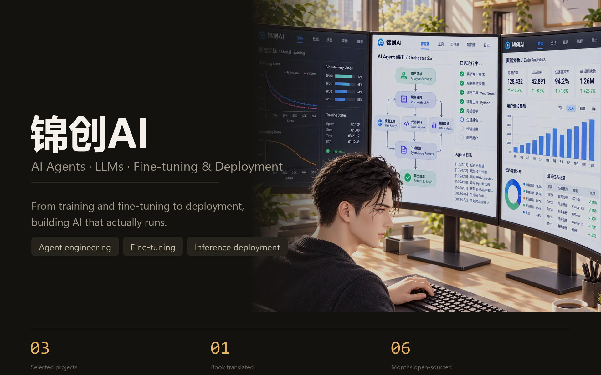
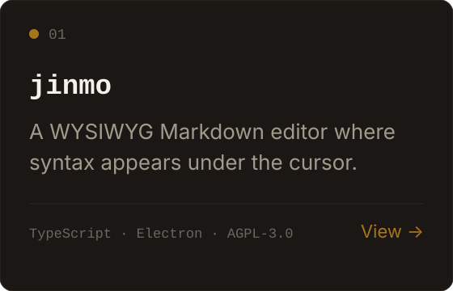
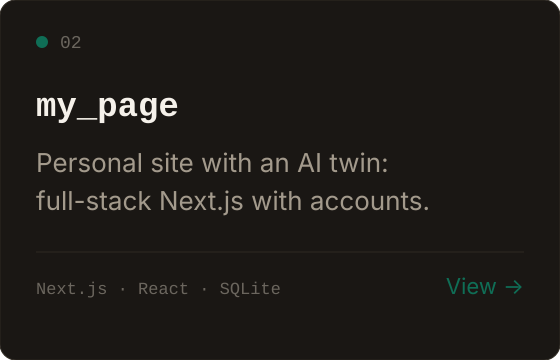
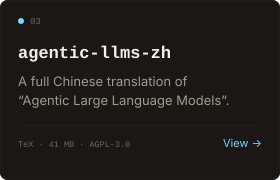

  

<a href="README.zh-CN.md">中文</a> · <b>English</b>

---

### About

Focused on AI agents and large language models. From training and fine-tuning to inference deployment and agent engineering, what matters to me is whether the whole chain actually runs — not whether a demo looks impressive.

---

### What I'm working on

| 01 | 02 | 03 |
|:---|:---|:---|
| **Make agents finish the job** | **Adapt models to real tasks** | **Ship it for real** |
| Multi-step planning, tool calls and self-reflection — turning a single answer into a process that converges. | Fine-tuning and quantization to move a general model into a state that solves a specific problem. | Inference acceleration and service deployment — from 'it runs' to 'it runs reliably at a cost you can afford'. |

---

### Projects

<table>
<tr>
<td width="33%" valign="top">

</td>
<td width="33%" valign="top">

</td>
<td width="33%" valign="top">

</td>
</tr>
</table>

---

### Tech stack

  <picture>
    <source media="(prefers-color-scheme: dark)" srcset="https://skillicons.dev/icons?i=python,pytorch,git,github,vscode&theme=dark">
    
  </picture>

**Foundations** · `Python` `Git` `GitHub`

**Deep learning** · `PyTorch` `Hugging Face` `Transformers` `Diffusers`

**LLM engineering** · `LLM fine-tuning` `Inference` `Deployment` `Quantization`

**AI Agent** · `ReAct` `Plan-and-Solve` `Reflection` `RAG` `MCP`

**Tooling** · `VS Code` `Codex` `Google Colab`

---

### Connect

  
  
  
  

WeChat official account — scan to follow

