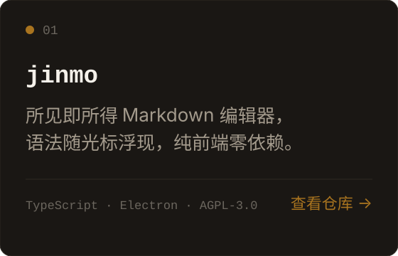
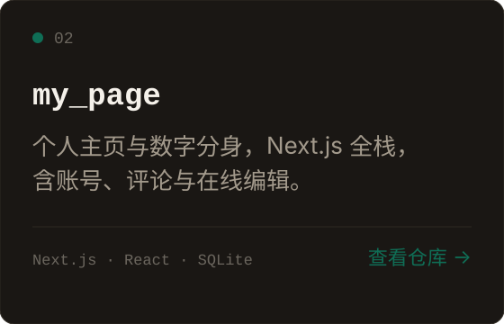
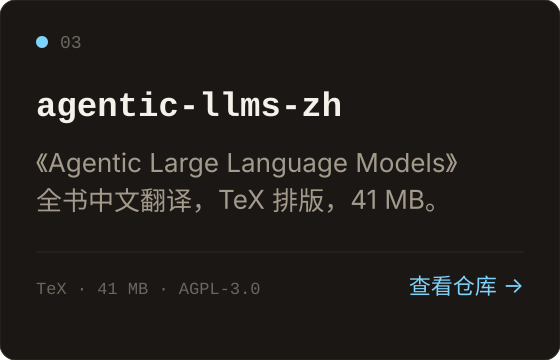

  

<b>中文</b> · <a href="README.md">English</a>

---

### 关于我

专注 AI Agent 与大模型技术。从模型训练、微调到推理部署，再到智能体工程，我关心的是这条链路能不能真正跑通——而不只是跑出一个能演示的 Demo。

---

### 我在做的事

| 01 | 02 | 03 |
|:---|:---|:---|
| **让 Agent 真正完成任务** | **让模型适配具体场景** | **让能力真正上线** |
| 多步规划、工具调用、自我反思——把一次问答变成一段能收敛的执行过程。 | 用微调和量化，把通用模型调整到能解决具体问题的状态。 | 推理加速与服务化部署，从「能跑」到「跑得起、跑得稳」。 |

---

### 项目

<table>
<tr>
<td width="33%" valign="top">

</td>
<td width="33%" valign="top">

</td>
<td width="33%" valign="top">

</td>
</tr>
</table>

---

### 技术栈

  <picture>
    <source media="(prefers-color-scheme: dark)" srcset="https://skillicons.dev/icons?i=python,pytorch,git,github,vscode&theme=dark">
    
  </picture>

**编程基础** · `Python` `Git` `GitHub`

**深度学习** · `PyTorch` `Hugging Face` `Transformers` `Diffusers`

**大模型工程** · `LLM 微调` `模型推理` `模型部署` `量化优化`

**AI Agent** · `ReAct` `Plan-and-Solve` `Reflection` `RAG` `MCP`

**开发工具** · `VS Code` `Codex` `Google Colab`

---

### 联系

  
  
  
  

微信公众号 · 扫码关注

